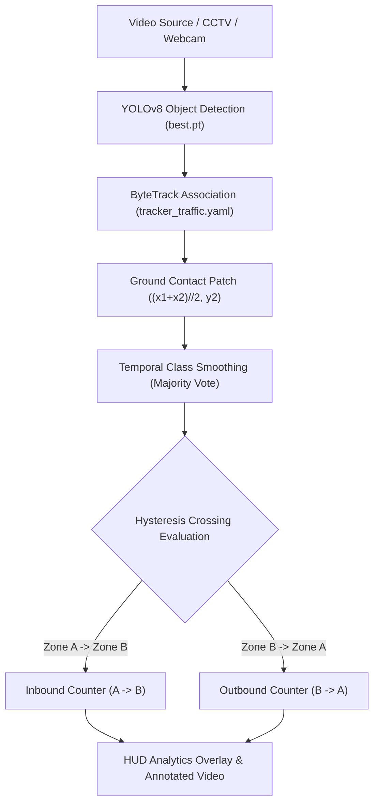

# 🚗 Vehicle AI: Real-Time Detection, ByteTrack Tracking & Bidirectional Counting

[](https://www.python.org/)
[](https://docs.ultralytics.com/)
[](https://github.com/ifzhang/ByteTrack)
[](https://pytorch.org/)
[](https://creativecommons.org/licenses/by/4.0/)

An end-to-end, high-accuracy Computer Vision system for real-time multi-class vehicle detection, persistent multi-object tracking, and bidirectional traffic flow analytics. Built with fine-tuned **YOLOv8**, **ByteTrack**, and **OpenCV**.

---

## 🌟 Key Features

* **Multi-Class Detection:** Accurately classifies and detects `bus`, `car`, `motorbike`, and `truck` in complex traffic scenarios.
* **Ground Contact Patch Tracking:** Uses the tire-road contact point `((x1+x2)//2, y2)` rather than the bounding box centroid, eliminating false crossings caused by camera perspective and vehicle height disparities.
* **Hysteresis Deadband:** Dual-threshold virtual counting zone (`upper_y` and `lower_y`) prevents boundary oscillation and eliminates duplicate counts when vehicles slow down or stop at the counting line.
* **Bidirectional Flow Analytics:** Automatically measures traffic flow separated into **Inbound ($A \rightarrow B$)** and **Outbound ($B \rightarrow A$)** directions.
* **Temporal Class Smoothing (Majority Voting):** Prevents classification flickering across video frames using rolling temporal voting per track ID.
* **Motion Trajectory Trails:** Real-time visual polylines illustrate vehicle paths and lane discipline.
* **Memory-Safe Tracking:** Automated eviction of inactive track IDs prevents memory leaks in 24/7 continuous CCTV streams.
* **Modern Analytics HUD:** Semi-transparent translucent dashboard displaying real-time FPS, active vehicles, directional counts, and per-class metrics.

---

## 🏗️ Pipeline Architecture



---

## 📊 Benchmark & Evaluation Results

Evaluated on the held-out test split (comparing original YOLOv8n baseline vs. new YOLOv8s enhanced model with gradient accumulation and augmented training):

| Metric | Baseline (YOLOv8n) | **Enhanced (YOLOv8s) 🚀** | Gain |
|---|:---:|:---:|:---:|
| **Precision** | `88.7%` | **`89.1%`** | `+0.4%` |
| **Recall** | `81.4%` | **`85.8%`** | **`+4.4%`** |
| **mAP@50** | `89.0%` | **`92.1%`** | **`+3.1%`** |
| **mAP@50-95** | `67.7%` | **`68.9%`** | `+1.2%` |

### Per-Class Test Performance (Enhanced Model):
* 🚌 **Bus:** `91.1% mAP@50` (Precision: 87.2%, Recall: 83.3%)
* 🚗 **Car:** `93.2% mAP@50` (Precision: 91.0%, Recall: 91.1%)
* 🏍️ **Motorbike:** `88.4% mAP@50` (Precision: 90.0%, Recall: 77.9%)
* 🚚 **Truck:** `95.7% mAP@50` (Precision: 88.1%, Recall: 90.8%)
* ⚡ **Inference Speed:** **20.9 ms/frame (~48 FPS)** on GTX 1650 Ti GPU

---

## 🚀 Quick Start

### 1. Launch the Interactive Web Dashboard (Easiest)

Run the full web interface to upload any image or video directly in your browser:

```bash
streamlit run app.py
```
* **Image Mode:** Upload any street/traffic photo, get instant bounding boxes, confidence badges, and vehicle count breakdowns.
* **Video Mode:** Drag-and-drop any traffic video, adjust counting line with an interactive slider, watch real-time tracking with trajectory trails, and download processed video and CSV reports.

---

### 2. Run CLI Vehicle Counting

Run the high-accuracy tracking pipeline with the tuned ByteTrack configuration, trajectory trails, and HUD:

```bash
python detect_count_advanced.py --source traffic.mp4
```

#### CLI Options:
```bash
python detect_count_advanced.py \
    --source traffic.mp4 \
    --weights runs/vehicle/roboflow_v2/weights/best.pt \
    --line 0.60 \
    --band 0.02 \
    --imgsz 960 \
    --conf 0.25 \
    --trails \
    --no-show
```

| Flag | Default | Description |
|---|---|---|
| `--source` | *Required* | Path to video file, RTSP stream, or webcam index (`0`) |
| `--weights` | `best.pt` | Path to trained model weights |
| `--line` | `0.60` | Position of counting line as fraction of height (`0.0` - `1.0`) |
| `--band` | `0.02` | Hysteresis band half-width to prevent boundary jitter |
| `--imgsz` | `960` | Inference resolution (e.g. `640`, `960`, `1280`) |
| `--conf` | `0.25` | Detection confidence threshold |
| `--trails` | `True` | Draw motion trajectory trails behind vehicles |
| `--no-show` | `False` | Run in headless mode without preview window |

---

### 3. Other Utility Scripts

* **Single-Line Counter:**
  ```bash
  python detect_count.py --source traffic.mp4
  ```
* **Single Image Detection:**
  ```bash
  python detect_image.py --source sample.jpg
  ```
* **Model Test Evaluation:**
  ```bash
  python evaluate.py
  ```
* **Confidence Threshold Sweep:**
  ```bash
  python threshold_test.py
  ```
* **Enhanced Model Training:**
  ```bash
  python train_enhanced.py --model yolov8s.pt --epochs 60 --batch 4 --accumulate 4
  ```

---

## 📁 Repository Structure

```
vehicle_ai_project/
├── assets/                     # Demo screenshots and visual assets
│   ├── sample_output_frame.jpg # Sample annotated output frame
│   └── traffic_detected.jpg    # Sample detection output
├── configs/                    # Tuned ByteTrack configurations
│   └── tracker_traffic.yaml    # Traffic-optimized ByteTrack hyperparameters
├── dataset/                    # Roboflow v2 dataset (train, valid, test splits)
│   └── data.yaml               # Classes: bus, car, motorbike, truck
├── weights/                    # Production model weights
│   └── vehicle_yolov8s_best.pt # High-accuracy fine-tuned YOLOv8s model (92.1% mAP)
├── app.py                      # Interactive Streamlit Web Dashboard
├── detect_count_advanced.py    # Production tracking & bidirectional counting engine
├── detect_count_direction.py   # Baseline bidirectional counting
├── detect_count.py             # Single-line crossing counter
├── detect_image.py             # Single-frame inference CLI
├── evaluate.py                 # Test-split evaluation script
├── threshold_test.py           # Confidence threshold sweep benchmark
├── train_enhanced.py           # Enhanced training script with gradient accumulation
├── requirements.txt            # Project dependencies
├── LICENSE                     # MIT License
└── README.md                   # Project documentation
```

---

## 📜 License

This project is licensed under the [MIT License](LICENSE).
